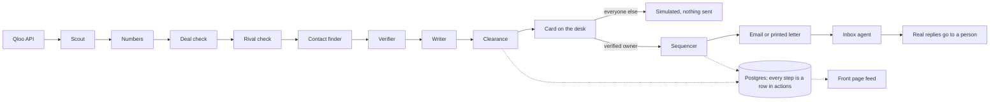

# SYZYGY

Taste data that books the deal. Live at [syzygybot.com](https://syzygybot.com).

Qloo can tell you Bad Bunny's fans lean toward Natti Natasha at 0.95. Somebody still has to find who signs at the other end, write to them, check the message won't get anyone sued, send it at a decent hour and read the reply.

SYZYGY is ten agents doing that somebody's job. Open a desk for a tour, a venue, a podcast or a brand. The agents work the cards across a board and leave them waiting for you: who to pitch, Qloo's score both ways, the person who decides, a drafted email or letter, and a clearance record. Nothing leaves until a person presses Approve.

Built for the [Qloo Agentic Hackathon](https://qloo.devpost.com/). MIT licensed.

## Try it

Go to [syzygybot.com/desk](https://syzygybot.com/desk) and pick a desk. No login.

- Pick a built-in one (Live Nation, Golden Globes, This Week in Startups and others).
- Or search a name, like "Hot Ones", and it sets up a desk on the spot.
- Not in Qloo? Type a website, like linear.app. SYZYGY reads the site and picks anchors, a few things Qloo does know whose audience looks like that business's. Every score on the desk is still Qloo's, measured against those anchors.

Approve is a simulation, so click whatever you like. It only sends for real on a desk you've proved is yours.

## How it works



| Agent | What it does |
|---|---|
| Scout | Pulls 12 candidates per lane out of Qloo |
| Numbers | Gets Qloo's score both ways and keeps the weaker one |
| Deal check | Drops anyone the subject already works with |
| Rival check | Drops their partners' direct competitors |
| Contact finder | Finds who decides, plus the inbox or postal address that organisation publishes |
| Verifier | Only keeps a contact it read on a real page. Personal emails are never guessed |
| Writer | Drafts the email, or a letter if there's no inbox |
| Clearance | Seven rules on every draft, plus a fixed ban on describing an audience by ethnicity, religion, health and so on |
| Sequencer | Sends in the recipient's window: Tue to Thu, 09:00 to 11:30 their time |
| Inbox | Sorts replies, honours opt-outs and bounces, hands real replies to a person |

Every step writes one row to `actions`. The front page feed is a view over that table, so if it isn't there it didn't happen.

## Sending for real

Proving a desk is yours means entering a six-digit code sent to an email at the desk's own domain. Free mail doesn't count. Without this anyone could post letters signed as Live Nation.

After that: five emails a day across all desks, one per company per day, ten letters a day. Every message says an AI agent wrote it and a person approved it, and carries an opt-out link and a postal address.

## Models are off right now

Google Cloud billing is switched off, so nothing is calling Gemini today. A desk that has run before plays back the steps and drafts its agents produced when Gemini was on. A desk that has never run gets a new run with live Qloo, cached contacts and a template writer (`lib/desks/housewriter.ts`).

Rival check and reply sorting drop to plain rules in this mode, so a brand-new desk can still pitch a competitor. The Gemini code is all still there, behind one gate in `lib/llm.ts`.

## Run it

```
npm install
cp .env.example .env.local    # then fill in the two keys below
npm run qloo:smoke            # checks the Qloo key
npm run db:migrate
npm run dev
```

You need `QLOO_API_KEY` and `DATABASE_URL`. Everything else in `.env.example` is optional, and nothing real goes out unless `MAIL_LIVE` or `POSTGRID_LIVE` is set.

Qloo hackathon keys only work on `https://hackathon.api.qloo.com`. The main host gives a 401. And Qloo ignores parameters it doesn't recognise, so a typo gets you an empty 200 instead of an error.

## Where to look

| | |
|---|---|
| `lib/qloo.ts` | Qloo client, with a parameter whitelist |
| `lib/live/` | a desk run, and desks built from a website |
| `lib/clearance.ts` | the rules |
| `lib/owners.ts` | proving a desk is yours |
| `lib/outbound.ts` | send gates, caps, windows |
| `db/schema.sql` | every table |

More in [docs/ARCHITECTURE.md](docs/ARCHITECTURE.md), [docs/DECISIONS.md](docs/DECISIONS.md) and [docs/PRICING.md](docs/PRICING.md). Built by [Onenept Studios](https://onenept.com).
