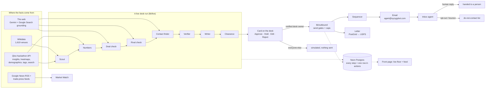

# SYZYGY

Taste data that books the deal. Live at [syzygybot.com](https://syzygybot.com).

Qloo can tell you that Bad Bunny's fans lean toward Natti Natasha at 0.95. That's the easy part. Somebody still has to find who signs at the other end, write to them, make sure the message won't get anyone sued, send it at a decent hour and read the reply.

SYZYGY is ten agents doing that somebody's job. You open a desk (a tour, a venue, a podcast, a brand team), a live run starts, and a few minutes later there are cards waiting for you: who to pitch, why the numbers say so, the person who decides, a drafted email or letter, and a clearance record. Nothing leaves until a person presses Approve.

Built for the [Qloo Agentic Hackathon](https://qloo.devpost.com/).

## Try it

Go to [syzygybot.com/desk](https://syzygybot.com/desk) and pick a desk. Six are written for a brand or entity, plus a Bad Bunny touring desk. Or search any name ("Nike", "Hot Ones") and SYZYGY sets up a desk for it on the spot.

Not in Qloo at all? Type the business's website instead. SYZYGY reads the site and picks anchors, a handful of podcasts, brands and shows Qloo does know whose audience is that business's. Then it runs the desk through them. Both numbers on every card are still Qloo's: how the anchors' audience leans toward a candidate, and how the candidate's audience leans back toward the anchors. The desk lists its anchors, and once you've verified the desk you can swap one and run it again. [Onenept's desk](https://syzygybot.com/desk/my-onenept-studios-nys) was set up this way from onenept.com.

Your browser gets its own workspace, so whatever you approve or reject is yours. Approving is a simulation unless you've proved the desk is yours (more on that below), so click around freely.

There's a six-page walkthrough of every page and button in [docs/how-syzygy-works.pdf](docs/how-syzygy-works.pdf).

## How it fits together



Every agent writes one row to the `actions` table for every step it takes. The front page is a view over that table. If an agent did something it shows up there, and if it isn't there it didn't happen. Each card also has a "How the agents got here" list with the time of every step.

## The ten agents

Scout pulls 12 candidates per lane out of Qloo, things like "brands Bad Bunny's fans lean toward" or "acts the crowd at this room likes".

Numbers asks Qloo for the score both ways and keeps the weaker one. A pair where only one side cares isn't a deal.

Deal check drops brands the talent already works with. Rival check goes one step further. It looks up who the subject is already partnered with, searches the web for each partner's direct competitors, and keeps those lists for 30 days. So Bad Bunny's desk won't pitch Nike, because Bad Bunny has an Adidas deal. Web rival lists are narrow ("fashion rivals of Calvin Klein" leaves out Zara), so before anything gets drafted Rival check also asks Clearance's exclusivity judge, which reads categories more widely.

Contact finder works out the person who decides, plus the inbox or postal address that organisation actually publishes. Verifier only keeps a contact it found on a page it read itself, because model-written links are wrong a lot of the time. Personal emails are never guessed.

Writer drafts the email, or a letter when there's no inbox. Gemini 4 Argon writes it, picked over 3.1 Pro and three Flash models in a blind test. 3.1 Pro takes over when Argon is slow.

Clearance runs seven rules on every draft: AI disclosure up front, no implied endorsement, the sending law in the recipient's country, letters only for Germany without consent, published addresses only, never pitch someone who's left the role, no category-exclusivity clash. There's also a fixed check that never describes an audience by ethnicity, sexuality, age, religion, politics, health or crime.

Sequencer and Inbox handle what happens after you approve. Emails wait for the recipient's window (Tuesday to Thursday, 09:00 to 11:30 their time). The mailbox is read every 15 minutes, and every reply gets sorted: interested, not now, referral, opt-out, out of office. An opt-out or a bounce cancels anything still queued for that address. A real human reply goes to a person with the whole thread.

Market Watch sits off to the side. It reads Google News and the search feeds of trade-press sites for the topics each desk cares about. It reads feeds on purpose. When we asked a model for news as JSON, it made up outlets.

## Sending for real

On a desk you've proved is yours, Approve really sends. Proving it means typing an email at the desk's own domain (livenation.com for the Live Nation desk, say) and entering the six-digit code that lands there. Free-mail addresses don't count. Neither do majors and big agencies, since thousands of people at Sony Music have nothing to do with one act. Without that check anyone could open the Live Nation desk and post letters signed as Live Nation.

After that it's caps and gates. Five real emails a day across all desks and one per company per day. Ten letters a day, because each one costs money. Every message says in its opening lines that an AI agent wrote it and a person approved it, and every one has an opt-out link and a postal address.

## Stack

Next.js 16 on Vercel, Neon Postgres, Vercel cron. Gemini on Vertex AI: 3.5 Flash-Lite for sorting and judging, 3.5 Flash for research with Google Search grounding, Argon for drafts. Email through Zoho, letters through PostGrid. The front page constellation is three.js.

The parts worth reading first:

| | |
|---|---|
| `lib/qloo.ts` | Qloo client. Refuses any parameter not on its whitelist |
| `lib/live/` | a desk run, lane by lane |
| `lib/rivals.ts` | Rival check |
| `lib/live/anchors.ts` | desks for businesses Qloo doesn't know |
| `lib/clearance.ts` | the seven rules |
| `lib/owners.ts` | desk ownership by email code |
| `lib/outbound.ts` | send gates, caps, sending windows |
| `lib/inbox.ts` | sorting replies |
| `db/schema.sql` | every table |

Crons in `vercel.json`: desks every 30 minutes (the built-in desk that's gone longest without a run gets one), mail every 15.

## Running it

```
npm install
vercel env pull .env.local
npm run qloo:smoke    # checks the Qloo key works
npm run db:migrate
npm run dev
```

You need `QLOO_API_KEY`, `DATABASE_URL` and the Vertex credentials (`GOOGLE_VERTEX_PROJECT`, `GOOGLE_VERTEX_CREDENTIALS_B64`). Mail and PostGrid are optional, and with `MAIL_LIVE` and `POSTGRID_LIVE` unset nothing real goes out.

One thing that'll save you an hour. Qloo hackathon keys only work on `https://hackathon.api.qloo.com`. The main host gives a 401 with the same key. And Qloo quietly ignores parameters it doesn't recognise, so a typo gets you an empty 200 instead of an error.

## License

MIT. Built by [Onenept Studios](https://onenept.com).
